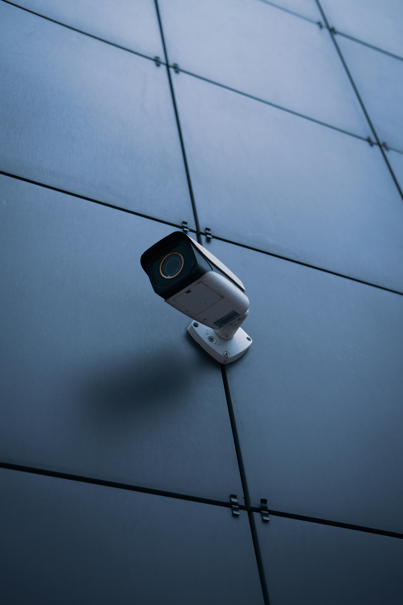
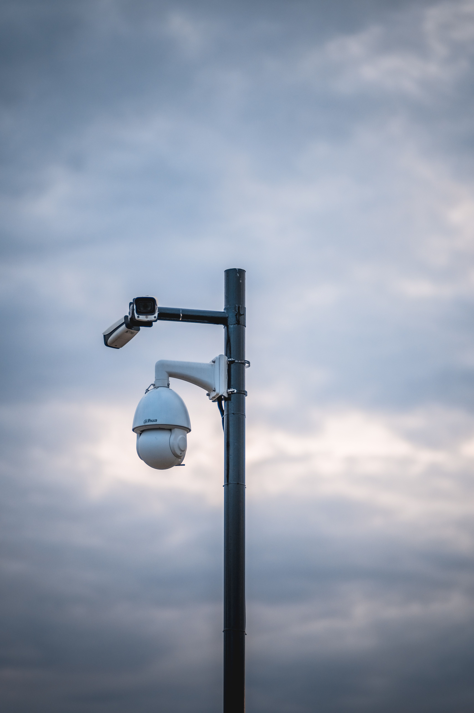

# 📸 Como Trocar as Imagens da Galeria

## Passo 1: Prepare suas imagens

1. **Escolha 6 fotos** das suas instalações de câmeras
2. **Formato:** JPG ou PNG
3. **Tamanho:** 1920x1080px (ou proporção similar)
4. **Otimize as imagens:**
   - Acesse [TinyPNG.com](https://tinypng.com)
   - Faça upload de cada imagem
   - Baixe as imagens otimizadas (ficarão entre 100KB-500KB)

## Passo 2: Renomeie e salve na pasta img

Renomeie suas imagens assim:
```
img/
├── gallery-1.jpg  (foto 1)
├── gallery-2.jpg  (foto 2)
├── gallery-3.jpg  (foto 3)
├── gallery-4.jpg  (foto 4)
├── gallery-5.jpg  (foto 5)
└── gallery-6.jpg  (foto 6)
```

Copie todas as 6 imagens para a pasta `img/` do projeto.

## Passo 3: Atualize o HTML (se necessário)

As imagens já estão configuradas no HTML. Você só precisa garantir que os arquivos estão na pasta correta com os nomes corretos.

**Localização no código:**
- Abra o arquivo `index.html`
- Procure pela seção `<!-- Seção Galeria -->` (aproximadamente linha 300)
- Você verá 6 blocos de código como este:

```html
<div class="col-lg-4 col-md-6" data-aos="fade-up" data-aos-delay="100">
    <div class="gallery-item">
        
    </div>
</div>
```

**Se quiser trocar a ordem ou descrições:**

Exemplo - trocar a primeira imagem:
```html
<!-- Antes -->


<!-- Depois (se quiser usar outra ordem) -->

```

## Pronto! 🎉

Suas novas imagens aparecerão automaticamente no site.

---

## Dicas Importantes

### 1. **Ordem de exibição**
- `gallery-1.jpg` = aparece PRIMEIRO (delay="100")
- `gallery-2.jpg` = aparece SEGUNDO (delay="150")
- `gallery-3.jpg` = aparece TERCEIRO (delay="200")
- E assim por diante...

### 2. **Texto alternativo (SEO)**
O atributo `alt` ajuda no Google e acessibilidade:
```html
✅ BOM: alt="Instalação CFTV Intelbras em condomínio Recife"
❌ RUIM: alt="img01"
```

### 3. **Tamanho das imagens**
- **Máximo:** 500KB por imagem
- **Ideal:** 200-300KB
- Use sempre o [TinyPNG.com](https://tinypng.com) para otimizar

### 4. **Nomes dos arquivos**
- ✅ Certo: `gallery-1.jpg`, `instalacao-01.jpg`
- ❌ Errado: `IMG_001.JPG`, `foto loja.jpg`

---

## Exemplo Prático

Você tem 6 fotos de instalações feitas:

1. `foto-tecnico-trabalhando.jpg` → salve como `gallery-1.jpg`
2. `kit-cftv-intelbras.jpg` → salve como `gallery-2.jpg`
3. `camera-bullet-externa.jpg` → salve como `gallery-3.jpg`
4. `central-monitoramento.jpg` → salve como `gallery-4.jpg`
5. `camera-dome-corredor.jpg` → salve como `gallery-5.jpg`
6. `cabeamento-organizado.jpg` → salve como `gallery-6.jpg`

Copie para a pasta `img/` e o site automaticamente exibirá as novas fotos!

---

## Problemas Comuns

### ❌ "A imagem não aparece"
**Solução:** Verifique se:
1. O nome do arquivo está correto (minúsculas, sem espaços)
2. A imagem está na pasta `img/`
3. A extensão é `.jpg` ou `.png`

### ❌ "Imagem muito lenta"
**Solução:** 
1. Use TinyPNG para reduzir o tamanho
2. Mantenha entre 200-500KB

### ❌ "Imagem cortada"
**Solução:** Use imagens com dimensões similares (16:9 ou 4:3)

---

**Precisou de ajuda?** É só seguir esses passos que funciona!